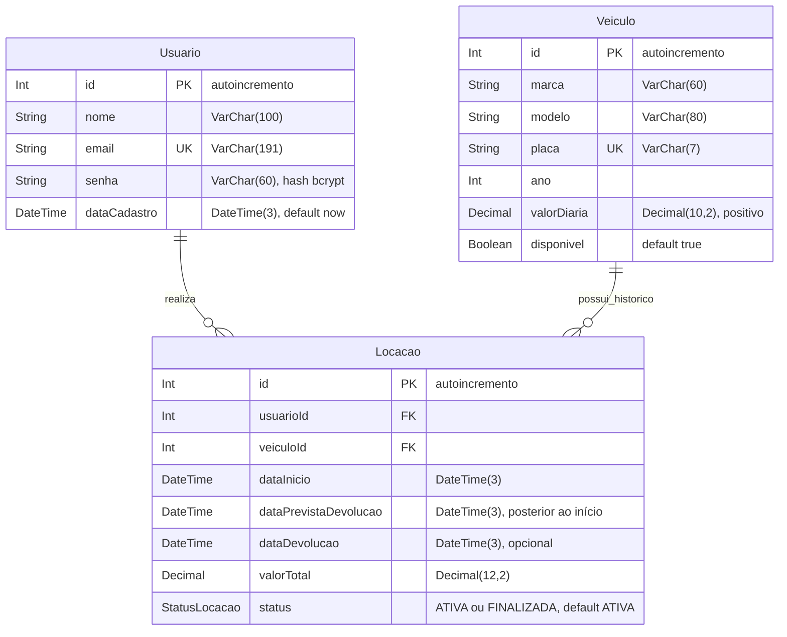
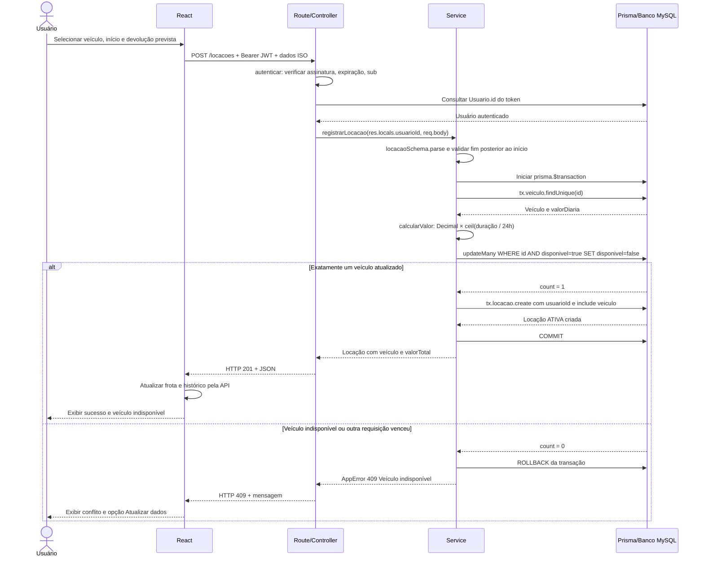

# Diagramas de referência

Estes diagramas refletem `backend/prisma/schema.prisma` e o fluxo de `registrarLocacao`. São material de estudo: cada aluno deve produzir sua versão individual, inteiramente à mão, em papel A4 branco sem pautas ou quadriculados, com nome completo. Não entregar impressão destes diagramas como manuscrito.

## DER

`usuarioId` referencia `Usuario.id`; `veiculoId` referencia `Veiculo.id`. Ambos são obrigatórios e **não são únicos**. Isso permite muitas locações no histórico de um mesmo usuário e veículo. Os dois relacionamentos usam `onDelete: Restrict`, protegendo o histórico. Os índices compostos são `(usuarioId, dataInicio)` e `(veiculoId, status)`; índice não significa restrição de unicidade. E-mail e placa têm unicidade própria.

A consistência de disponibilidade é assegurada pelo Service transacional. `disponivel` não representa agenda de reservas: a locação iniciada já ocupa o veículo, independentemente do período informado. Não há recurso de reserva futura.

## Sequência — registrar locação

Antes da transação, datas inválidas produzem 400. Dentro dela, veículo inexistente produz 404. Token ausente, inválido ou expirado interrompe o fluxo antes do Controller protegido com 401. Exceções após a alteração da disponibilidade também desfazem a transação, sem locação ou bloqueio parcial persistido. A verificação decisiva de disponibilidade é a atualização condicional; a consulta do veículo serve para existência e diária.

Na devolução, `finalizarLocacao` consulta uma locação do proprietário, atualiza condicionalmente `ATIVA` com `dataDevolucao = null`, exige `count = 1`, libera o veículo e confirma tudo na mesma transação. Uma repetição retorna 409; outro usuário recebe 404, sem revelar a locação.
